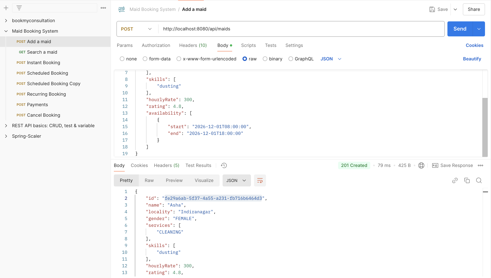
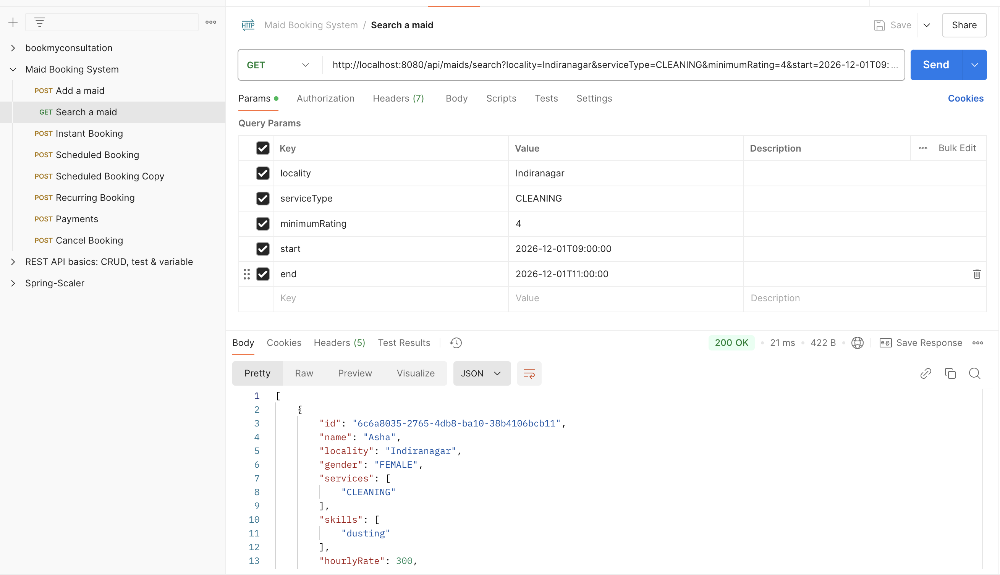
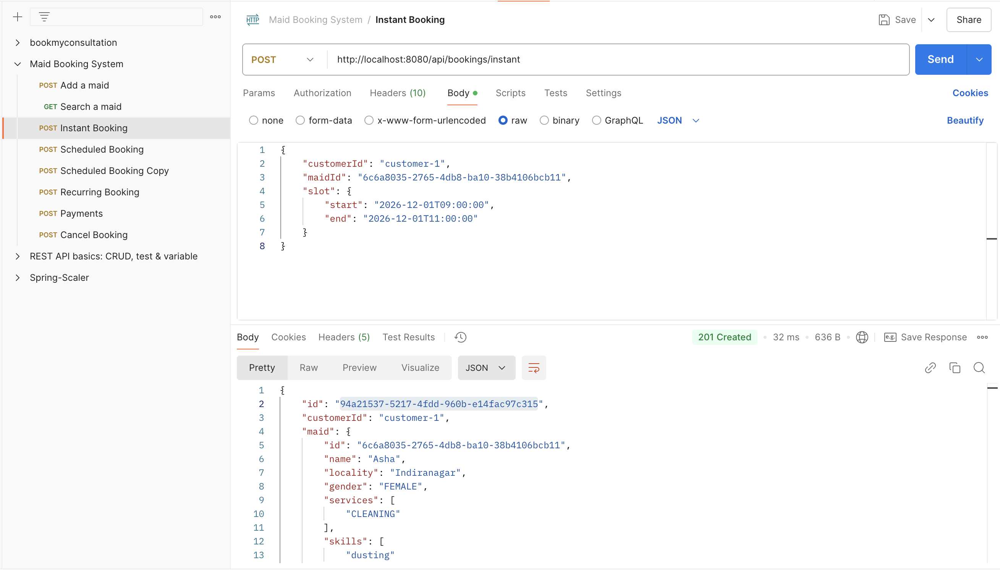
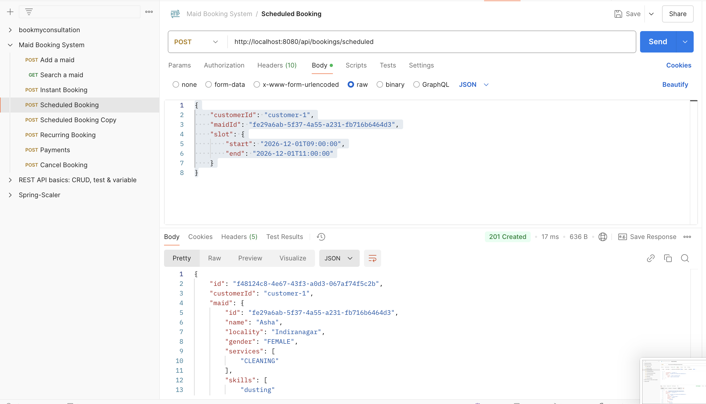
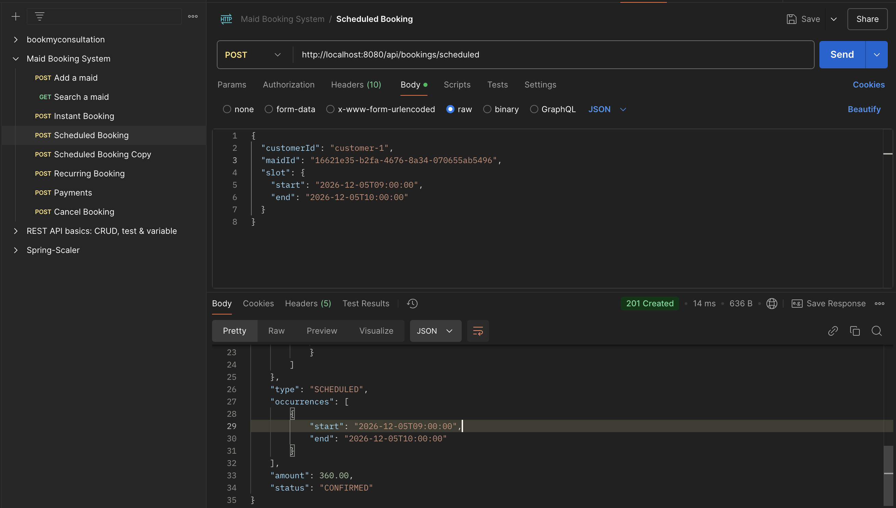
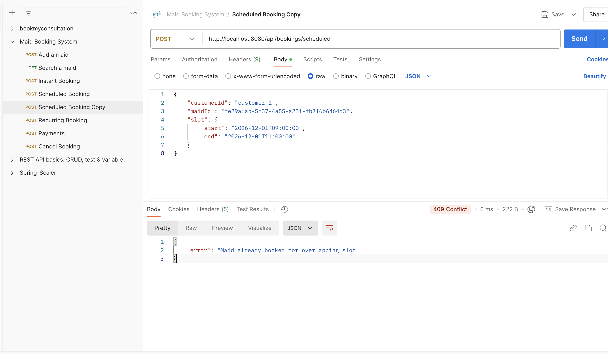
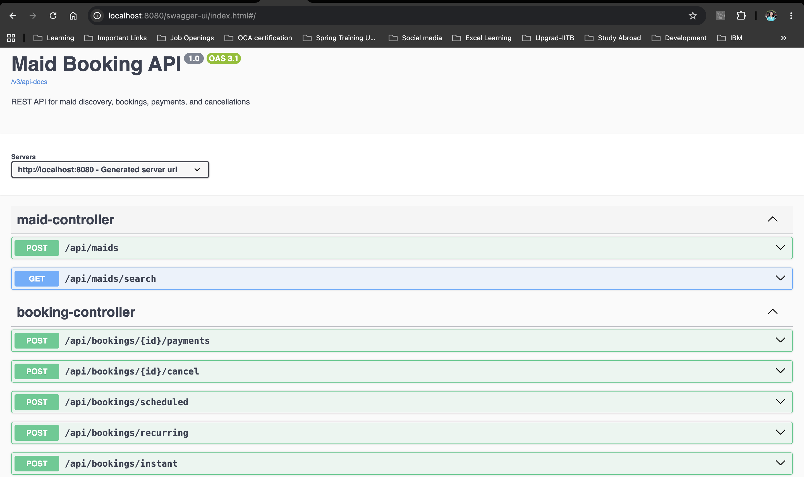

# Maid Booking Service

A runnable Spring Boot 4 service demonstrating maid discovery, booking, payment, cancellation, and overlap-safe inventory handling.

## Run

Requirements: Java 17+

```bash
./mvnw spring-boot:run
```

Run tests:

```bash
./mvnw test
```

The service starts at `http://localhost:8080`.

Swagger UI is available at `http://localhost:8080/swagger-ui/index.html`; the OpenAPI document is at `http://localhost:8080/v3/api-docs`.

## API examples

Add a maid:

```bash
curl -X POST http://localhost:8080/api/maids -H 'Content-Type: application/json' -d '{"name":"Asha","locality":"Indiranagar","gender":"FEMALE","services":["CLEANING"],"skills":["dusting"],"hourlyRate":300,"rating":4.8,"availability":[{"start":"2026-12-01T08:00:00","end":"2026-12-01T18:00:00"}]}'
```

Search:

```bash
curl 'http://localhost:8080/api/maids/search?locality=Indiranagar&serviceType=CLEANING&minimumRating=4&start=2026-12-01T09:00:00&end=2026-12-01T11:00:00'
```

The add-maid response contains the generated maid ID. Use it for these requests:

```bash
curl -X POST http://localhost:8080/api/bookings/scheduled -H 'Content-Type: application/json' -d '{"customerId":"customer-1","maidId":"MAID_ID","slot":{"start":"2026-12-01T09:00:00","end":"2026-12-01T11:00:00"}}'

curl -X POST http://localhost:8080/api/bookings/BOOKING_ID/payments -H 'Content-Type: application/json' -H 'Idempotency-Key: payment-key-001' -d '{"method":"UPI"}'

curl -X POST 'http://localhost:8080/api/bookings/BOOKING_ID/cancel?occurrenceStart=2026-12-01T09:00:00'
```

For recurring bookings, post to `/api/bookings/recurring` with `startDate`, `days`, `startTime`, `durationMinutes`, and `endDate`.

## Screenshots

Save your screenshots in `docs/screenshots/`, then replace the filenames below.

### Add a maid



### Search available maids



### Booking endpoints

#### Instant booking



#### Scheduled booking

| Request | Response |
|---|---|
|  |  |

### Overlap prevention



### Swagger / OpenAPI


